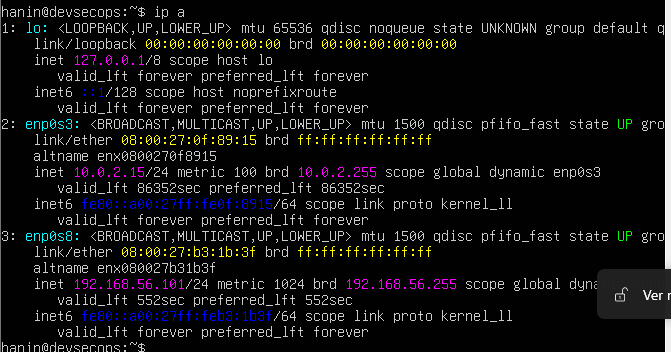
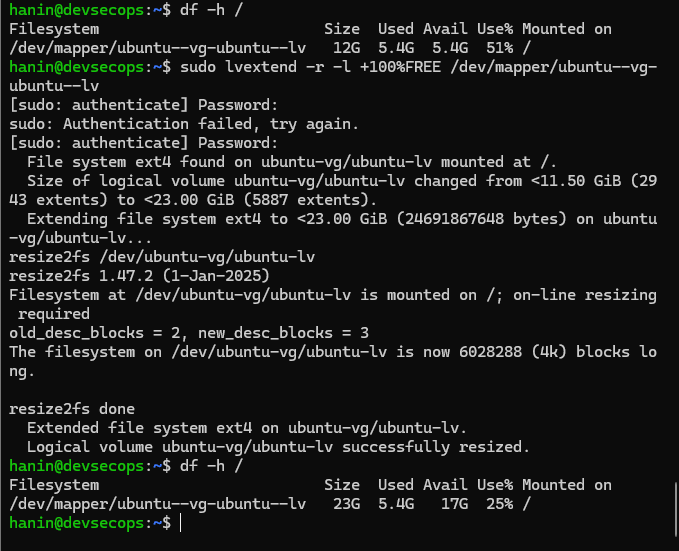
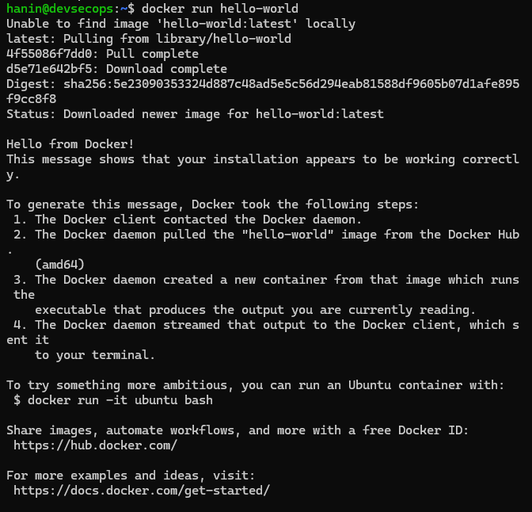
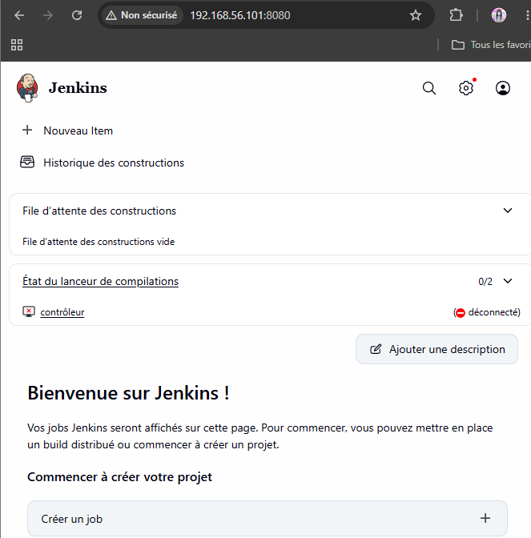
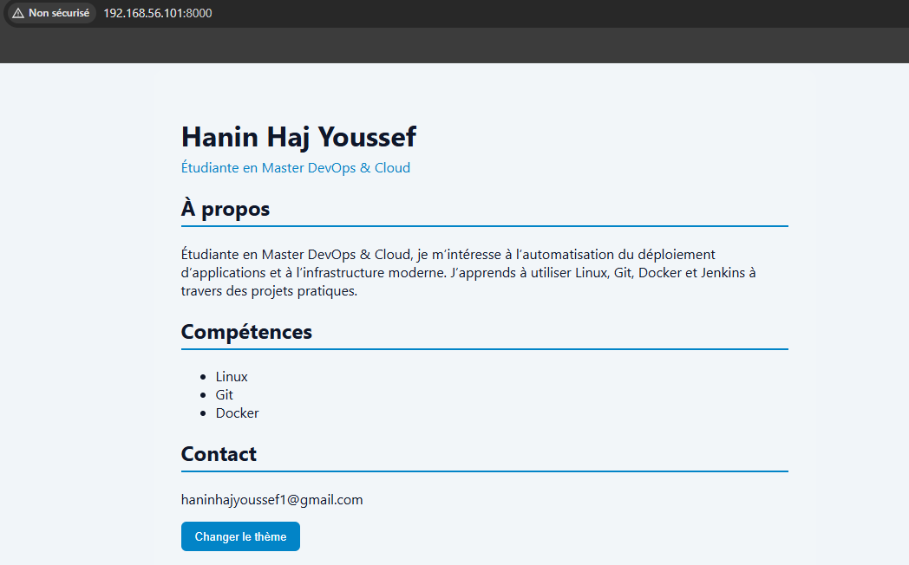
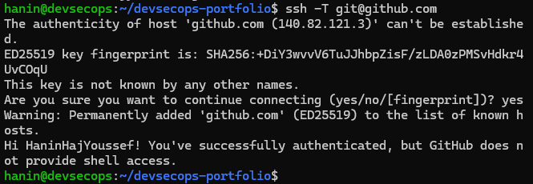
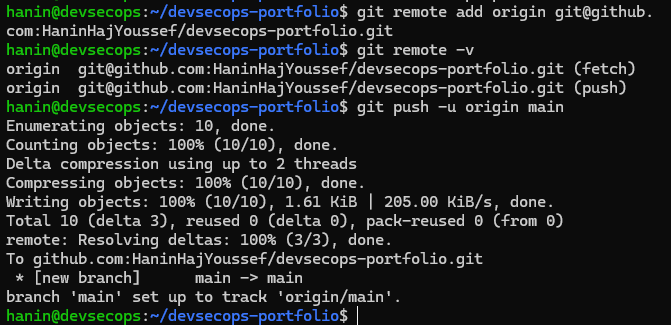

# DevSecOps Portfolio

Activité 1 – Master DevOps & Cloud  
Étudiante : Hanin Haj Youssef  
Dépôt : https://github.com/HaninHajYoussef/devsecops-portfolio

---

## I. Mise en place initiale

### 1. Installation d'Ubuntu Server 26.04 et accès SSH

La VM est créée avec VirtualBox (4 CPU, 6 Go de RAM, disque de 25 Go).
Deux cartes réseau sont utilisées :

- **Adaptateur 1 (NAT)** : accès à Internet pour la VM.
- **Adaptateur 2 (Host-only, réseau 192.168.56.0/24)** : adresse fixe `192.168.56.101`, qui reste la même quel que soit le réseau Wi-Fi de la machine physique.

Pendant l'installation, le paquet **OpenSSH server** a été coché. Vérification :

```bash
ip a
systemctl status ssh
```



Le volume logique n'utilisait que 11,5 Go sur les 23 Go de la partition. Il a été étendu :

```bash
sudo lvextend -r -l +100%FREE /dev/mapper/ubuntu--vg-ubuntu--lv
df -h /
```



### 2. Test de l'accès SSH depuis la machine physique

Depuis PowerShell sur la machine physique :

```bash
ssh hanin@192.168.56.101
```


### 3. Installation de Docker

```bash
sudo apt update
sudo apt install -y docker.io docker-compose-v2
sudo systemctl enable --now docker
sudo usermod -aG docker $USER
newgrp docker
docker --version
docker compose version
docker run hello-world
```



### 4. Installation de Jenkins en tant que service

```bash
sudo apt install -y fontconfig openjdk-21-jre
curl -fsSL https://pkg.jenkins.io/debian-stable/jenkins.io-2026.key | sudo tee /usr/share/keyrings/jenkins-keyring.asc > /dev/null
echo "deb [signed-by=/usr/share/keyrings/jenkins-keyring.asc] https://pkg.jenkins.io/debian-stable binary/" | sudo tee /etc/apt/sources.list.d/jenkins.list > /dev/null
sudo apt update
sudo apt install -y jenkins
sudo systemctl enable --now jenkins
systemctl status jenkins
sudo cat /var/lib/jenkins/secrets/initialAdminPassword
```

Le service Jenkins est actif :


Accès depuis la machine physique sur `http://192.168.56.101:8080` :



### 5. Mini CV One Page (HTML5 / CSS3 / JavaScript)

Le CV est dans le dossier `devsecops-portfolio`, géré avec Git :

```bash
mkdir ~/devsecops-portfolio && cd ~/devsecops-portfolio
git init -b main
git add .
git commit -m "Ajout du mini CV"
```

Vérification depuis la machine physique avec un serveur temporaire (`python3 -m http.server 8000`) :



### 6. Push GitHub via SSH

Génération de la clé, puis ajout de la clé publique dans GitHub (Settings > SSH and GPG keys > New SSH key) :

```bash
ssh-keygen -t ed25519 -C "haninhajyoussef1@gmail.com"
cat ~/.ssh/id_ed25519.pub
ssh -T git@github.com
```



Configuration du dépôt local pour utiliser SSH et premier push :

```bash
git remote add origin git@github.com:HaninHajYoussef/devsecops-portfolio.git
git remote -v
git push -u origin main
```



---

## II. Évolution vers DevSecOps Portfolio

### 7. Nouvelle version du portfolio

Le mini CV devient un portfolio avec les sections **About, Skills, Projects, Experience, Contact**.

Principales améliorations :

- barre de navigation fixe avec ancres vers chaque section ;
- thème clair / sombre grâce à des variables CSS ;
- mise en page responsive en cartes (CSS Grid) ;
- contenu des projets généré en JavaScript.


### 8. Section DevSecOps Skills

Cette section affiche les technologies utilisées : Git, Docker, Jenkins, Kubernetes, Ansible, Terraform, Argo CD.


### 9. Section Projects générée dynamiquement

Extrait de `script.js` :

```js
const projects = [
  { name: "Portfolio Docker", description: "Portfolio servi par Nginx dans un conteneur.", tech: "Docker, Nginx" },
  { name: "Intégration continue", description: "Jenkins installé en service sur Ubuntu Server.", tech: "Jenkins, Git" },
  { name: "Automatisation", description: "Création de VM avec Vagrant.", tech: "Vagrant, Linux" }
];

const list = document.getElementById("projects-list");
list.innerHTML = projects.map(p =>
  `<div class="card"><h3>${p.name}</h3><p>${p.description}</p><small>${p.tech}</small></div>`
).join("");
```


---

## III. Dockerisation initiale

*À compléter (étapes 10 à 14).*

## IV. Première introduction à l'automatisation

*À compléter (étapes 15 à 17).*
